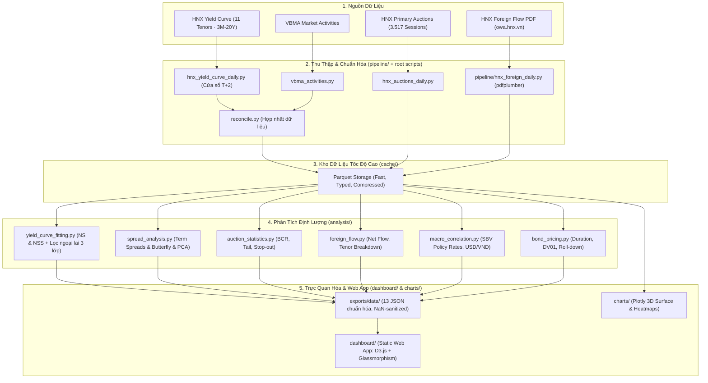

# 📊 VN Bond Yield Pipeline

[](https://www.python.org/)
[](https://opensource.org/licenses/MIT)
[](https://hnx.vn)
[](https://hnx.vn)
[](#s7)
[](https://d3js.org/)
[](https://github.com/FTU-kudo/VN_Bond_Yield_pipeline/actions)

> **Hệ sinh thái thu thập dữ liệu tự động, phân tích định lượng (Quantitative Analysis) & trực quan hóa toàn diện thị trường Trái Phiếu Chính Phủ Việt Nam (TPCP / Vietnam Government Bonds).**
>
> Nguồn dữ liệu chính: **Sở Giao dịch Chứng khoán Hà Nội (HNX)** — đường cong lợi suất chính thức, kết quả đấu thầu sơ cấp, báo cáo dòng vốn khối ngoại (PDF) — và **Hiệp hội Thị trường Trái phiếu Việt Nam (VBMA)** làm nguồn đối chiếu. Kết quả xuất bản dưới dạng web tĩnh 100% client-side, triển khai tự động qua GitHub Actions.

---

## 📑 Mục Lục

1. [🌟 Điểm Nổi Bật](#s1)
2. [🏛️ Kiến Trúc Hệ Thống & Luồng Dữ Liệu](#s2)
3. [📁 Cấu Trúc Thư Mục Dự Án](#s3)
4. [📊 Quy Mô Dữ Liệu Trong Hệ Thống](#s4)
5. [⚙️ Cài Đặt & Khởi Chạy Nhanh](#s5)
6. [🚀 Hướng Dẫn Vận Hành Pipeline](#s6)
7. [🧪 Kiểm Thử](#s7)
8. [🖥️ Trực Quan Hóa & Web Dashboard](#s8)
9. [📈 Cơ Sở Định Lượng & Mô Hình Toán Học](#s9)
10. [🛡️ Chất Lượng Dữ Liệu & Các Bẫy Đã Khắc Phục](#s10)
11. [📖 Giải Thích Thuật Ngữ](#s11)
12. [🤖 Tự Động Hóa (GitHub Actions)](#s12)
13. [❓ Hỏi Đáp Nhanh (FAQ)](#s13)
14. [⚖️ Tuyên Bố Miễn Trừ & Giấy Phép](#s14)

---

<a id="s1"></a>

## 🌟 Điểm Nổi Bật & Tính Năng

### 📡 Thu thập dữ liệu đa nguồn tự động & bền bỉ
- **Đường cong lợi suất chính thức HNX**: 11 kỳ hạn công bố (3M → 20Y), 3 chuẩn quy ước (*spot ghép lãi năm*, *spot ghép lãi liên tục*, *par yield*), **102.480 dòng** từ 19/03/2013 đến nay — cửa sổ quét theo **ngày thanh toán T+2** đúng bằng ô ngày mà hnx.vn hiển thị mặc định.
- **Đấu thầu sơ cấp HNX**: **3.517 phiên** phát hành/ phát hành thêm (reopening) từ 06/08/2012 — lãi suất trúng thầu, khối lượng gọi/đặt/trúng, BCR.
- **Dòng vốn khối ngoại**: tự động tải PDF từ FTP `owa.hnx.vn`, bóc tách bằng `pdfplumber` — **3.445 ngày giao dịch** NĐTNN từ 02/01/2013.
- **Đối chiếu VBMA**: dữ liệu hoạt động thị trường từ Hiệp hội Thị trường Trái phiếu Việt Nam.
- **Bền bỉ**: cache ngày nghỉ (`checked_dates.parquet`), tự động retry ngày chưa xuất bản, refresh 3 ngày thanh toán gần nhất (ghi đè số cũ bằng bản HNX cuối ngày).

### 📐 Mô hình toán học & định lượng chuẩn quốc tế
- **Nelson-Siegel (NS) 4 tham số** và **Nelson-Siegel-Svensson (NSS) 6 tham số** — ước lượng hàng loạt bằng *Vectorized Batch Profiled OLS* (~40× nhanh hơn vòng lặp `curve_fit`), tinh chỉnh bằng `scipy.optimize.curve_fit` cho từng ngày đơn lẻ; **3.434 ngày fit thành công** (RMSE trung vị ~0,8 bps).
- **Lưới đường cong 20 kỳ hạn** từ 1M → 30Y (1M/2M/18M/4Y… là giá trị mô hình nội suy/ngoại suy — HNX chỉ công bố 11 mốc).
- **Phân tích Term Spread đa dạng**: presets chuẩn `10Y-2Y`, `10Y-3M`, `10Y-1Y`, `5Y-2Y`, `15Y-10Y`, `30Y-10Y`, chỉ số bướu `Butterfly 2s5s10s` & `5s10s15s`, phân loại trạng thái đường cong (Inverted/Flat/Normal/Steep).
- **Custom Tenor Pair**: chọn bất kỳ cặp kỳ hạn nào 1M → 30Y, tính real-time từ đường cong đã fit.
- **Thống kê đấu thầu**: Success Rate, Bid-to-Cover Ratio (BCR), Stop-out Rate, Auction Tail, khối lượng theo quý.
- **PCA (Phân tích Thành phần Chính)** của biến động đường cong: 3 thành phần Level/Slope/Curvature giải thích ~86% phương sai trên dữ liệu đã làm sạch.
- **Định giá & rủi ro**: Clean/Dirty Price theo quy ước **ACT/ACT (Thông tư 30/2023/TT-BTC)**, YTM, Modified Duration, DV01, Convexity, Carry + Roll-down, Breakeven, Z-Spread, Thang rủi ro 12 kỳ hạn.

### 🖥️ Web Dashboard tĩnh phong cách Glassmorphism
- **5 trang**: Tổng quan · Đường cong lợi suất · Đấu thầu · Dòng vốn ngoại · **Cẩm nang thuật ngữ (MathJax)**.
- **Nút bật/tắt nguồn số liệu `[Fit NS | 🌐 HNX chính thức]`** trên *Bảng Lợi Suất Hiện Tại*: so sánh **từng số 1-1** với bảng công bố trên hnx.vn (kỳ hạn HNX không công bố hiển thị "—").
- **2 badge thời điểm tách bạch**: `Cập nhật lúc …` (giờ export dashboard) và `🕒 HNX lấy lúc …` (giờ pipeline chụp bảng HNX) — không còn nhầm thời điểm lấy số.
- **Interactive Term Spread Manager**: slider ngày có bong bóng nổi, tooltip xem trước, thước ngắm bám trục X, preset + custom pair, bộ lọc khoảng thời gian đồng bộ.
- **Bảng đấu thầu Sticky Header**, thanh lọc `30/60/90 Ngày · 6 Tháng · 1 Năm · Tất cả`.
- 100% **HTML5 + Vanilla CSS + D3.js** — không cần backend, chạy được trên GitHub Pages.

### 🤖 Tự động hóa CI/CD không cần server
- GitHub Actions chạy hằng ngày, **tự chờ tới 18:10 ICT** nếu cron kích hoạt sớm (lấy bản HNX đã chốt cuối ngày), quét cửa sổ **T+2**, phân tích, export JSON và commit dữ liệu mới lên `main`.

---

<a id="s2"></a>

## 🏛️ Kiến Trúc Hệ Thống & Luồng Dữ Liệu

Hệ thống được thiết kế theo mô hình 5 lớp module hóa cao:



---

<a id="s3"></a>

## 📁 Cấu Trúc Thư Mục Dự Án

```text
VN_Bond_Yield_pipeline/
├── 📁 pipeline/                      # Module thu thập & tiền xử lý dùng chung
│   ├── common.py                     # Parse HTML, parse số kiểu VN, add_business_days, daily_scan (cache tăng dần)
│   └── hnx_foreign_daily.py          # Cào & bóc tách PDF dòng vốn ngoại qua pdfplumber
├── 📁 analysis/                      # Động cơ phân tích định lượng (Quantitative Engine)
│   ├── yield_curve_fitting.py        # NS/NSS, lưới fit 20 kỳ hạn, lọc ngoại lai 3 lớp, Spot/Par/Forward
│   ├── bond_pricing.py               # Định giá TPCP (ACT/ACT), YTM, Duration, DV01, Convexity, Roll-down
│   ├── spread_analysis.py            # Term spreads, Butterfly, PCA Level/Slope/Curvature, regime, volatility
│   ├── auction_statistics.py         # Thống kê đấu thầu: BCR, stop-out, tail, success rate
│   ├── foreign_flow.py               # Phân tích dòng vốn khối ngoại mua/bán ròng
│   └── macro_correlation.py          # Tương quan lãi suất điều hành SBV & tỷ giá USD/VND
├── 📁 dashboard/                     # Web Dashboard tĩnh (Glassmorphism & D3.js)
│   ├── index.html                    # Trang tổng quan: KPI, đường cong, bảng lợi suất (toggle HNX), Spread Manager
│   ├── yield_curve.html              # Phân tích chi tiết đường cong & so sánh lịch sử (NS vs NSS)
│   ├── auctions.html                 # Phân tích chi tiết kết quả đấu thầu sơ cấp
│   ├── foreign_flows.html            # Phân tích chi tiết dòng vốn NĐTNN
│   ├── glossary.html                 # Cẩm nang thuật ngữ & công thức MathJax (8 phần)
│   └── assets/
│       ├── style.css                 # Design System Dark/Light Glassmorphism
│       └── app.js                    # Core D3.js renderers, sliders, filters, state
├── 📁 charts/                        # Script biểu đồ chuyên sâu Plotly
│   ├── yield_curve_3d.py             # Yield Surface 3D theo thời gian
│   ├── heatmap_yield.py              # Heatmap lợi suất (Kỳ hạn × Ngày)
│   └── auction_dashboard.py          # Dashboard 4-panel đấu thầu
├── 📁 cache/                         # Kho Parquet nén (cam kết vào repo, ~30 file)
│   ├── hnx_yield_curve_daily.parquet #   102.480 dòng curve HNX thô (11 tenor × 3 chuẩn)
│   ├── hnx_auctions_daily.parquet    #   3.517 phiên đấu thầu
│   ├── foreign_daily_flow.parquet    #   3.445 ngày dòng vốn ngoại
│   ├── combined_tpcp_yields.parquet  #   105.260 dòng hợp nhất (curve + auctions + VBMA)
│   ├── fitted_curve_ns/nss.parquet   #   Đường cong fit 20 kỳ hạn × 3.434 ngày
│   ├── fitted_params_ns/nss.parquet  #   Tham số β0 β1 β2 λ (+RMSE) từng ngày
│   ├── spread_analysis.parquet       #   30 cột spread/butterfly/regime/vol theo ngày
│   ├── bond_risk_ladder.parquet      #   Thang rủi ro 12 kỳ hạn (Duration/DV01/…)
│   └── *_checked_dates.parquet       #   Cache ngày đã quét / ngày nghỉ (tránh HTTP thừa)
├── 📁 exports/data/                  # 13 file JSON chuẩn hóa cho Web Dashboard
│   ├── fitted_curve_ns.json          #   Lưới 1,000 ngày gần nhất (dashboard tải nhanh)
│   ├── fitted_curve_ns_full.json     #   Bản đầy đủ toàn lịch sử
│   ├── hnx_yield_curve.json          #   Số HNX CHÍNH THỨC (spot_annual) — đối chiếu 1-1
│   ├── spread_analysis.json          #   Lịch sử term spread (3.434 phiên)
│   ├── fitted_params_ns/nss.json     #   Tham số model
│   ├── bond_risk_ladder.json         #   Thang rủi ro
│   ├── bond_rolldown_history.json    #   Lịch sử Carry & Roll-down 1.000 phiên
│   ├── curve_pca.json                #   PCA 3 thành phần (summary + loadings + scores)
│   ├── auction_stats.json            #   Thống kê đấu thầu tổng hợp
│   ├── foreign_flow.json             #   Dòng vốn ngoại {daily: [...]}
│   └── metadata.json                 #   Giờ export + giờ chụp HNX + ngày dữ liệu mới nhất
├── 📁 tests/
│   └── test_sovereign_quant.py       # 15 unit test: giá HNX, đường cong, lọc ngoại lai, daily_scan…
├── 📁 .github/workflows/
│   ├── daily_update.yml              # Daily: chờ 18:10 ICT → quét T+2 → analyze → export → commit
│   └── backfill.yml                  # Backfill lịch sử thủ công (workflow_dispatch)
├── hnx_yield_curve_daily.py          # Cào curve HNX theo NGÀY THANH TOÁN (cửa sổ T+2)
├── hnx_auctions_daily.py             # Cào kết quả đấu thầu sơ cấp HNX
├── vbma_activities.py                # Cào dữ liệu đối chiếu từ VBMA
├── reconcile.py                      # Hợp nhất các nguồn thành combined_tpcp_yields.parquet
├── run_pipeline.py                   # Entrypoint điều khiển toàn bộ pipeline
├── requirements.txt                  # Danh sách thư viện phụ thuộc
├── index.html                        # Trang chuyển hướng root → dashboard/ (GitHub Pages)
├── .env.example                      # Template biến môi trường (VBMA credentials…)
├── LICENSE                           # Giấy phép MIT
└── README.md                         # Tài liệu này
```

---

<a id="s4"></a>

## 📊 Quy Mô Dữ Liệu Trong Hệ Thống

| Nhóm Dữ Liệu | Nguồn | Cache Parquet | Export JSON | Quy Mô | Phạm Vi Thời Gian |
| :--- | :--- | :--- | :--- | :--- | :--- |
| **Đường cong lợi suất HNX** | hnx.vn (11 tenor × 3 chuẩn) | `hnx_yield_curve_daily.parquet` | `hnx_yield_curve.json` | **102.480 dòng** | 19/03/2013 – nay |
| **Hợp nhất TPCP** | Curve + Đấu thầu + VBMA | `combined_tpcp_yields.parquet` | *(nội bộ)* | **105.260 dòng** | 06/08/2012 – nay |
| **Đường cong fit NS/NSS** | Mô hình Nelson-Siegel | `fitted_curve_ns/nss.parquet` | `fitted_curve_ns.json` (+`_full`) | **3.434 ngày × 20 kỳ hạn** (67.750 điểm) | 06/08/2012 – nay |
| **Tham số NS/NSS** | Batch Profiled OLS | `fitted_params_ns/nss.parquet` | `fitted_params_ns/nss.json` | β0, β1, β2, λ (+ RMSE) | 06/08/2012 – nay |
| **Lịch sử Term Spread** | Từ đường cong fit | `spread_analysis.parquet` | `spread_analysis.json` | **3.434 ngày × 30 cột** | 06/08/2012 – nay |
| **Đấu thầu sơ cấp** | HNX Đấu thầu TPCP | `hnx_auctions_daily.parquet` | `auction_stats.json` | **3.517 phiên** | 06/08/2012 – nay |
| **Dòng vốn khối ngoại** | PDF FTP `owa.hnx.vn` | `foreign_daily_flow.parquet` | `foreign_flow.json` | **3.445 ngày** | 02/01/2013 – nay |
| **Thang rủi ro TPCP** | bond_pricing.py | `bond_risk_ladder.parquet` | `bond_risk_ladder.json` | 12 kỳ hạn (ngày mới nhất) | hằng ngày |
| **PCA đường cong** | spread_analysis.py | `curve_pca_*.parquet` | `curve_pca.json` | 3 thành phần (~86% phương sai) | toàn lịch sử |

---

<a id="s5"></a>

## ⚙️ Cài Đặt & Khởi Chạy Nhanh

### 1. Yêu cầu môi trường
- Python **3.10+**, Git.
- Truy cập mạng tới `hnx.vn` / `owa.hnx.vn` khi chạy chế độ thu thập (chế độ `analyze`/`export` chạy hoàn toàn offline từ cache).

### 2. Cài đặt

```bash
# Clone repository
git clone https://github.com/FTU-kudo/VN_Bond_Yield_pipeline.git
cd VN_Bond_Yield_pipeline

# Môi trường ảo (khuyến nghị)
python -m venv .venv
source .venv/bin/activate        # Linux/macOS
# .venv\Scripts\activate         # Windows

# Cài thư viện
pip install -r requirements.txt
```

**Phụ thuộc chính** (`requirements.txt`): `numpy`, `pandas`, `pyarrow`, `scipy`, `requests`, `plotly`, `pdfplumber`, `yfinance`, và thư viện nạp dữ liệu `vnbond` (cài trực tiếp từ Git).

### 3. Biến môi trường (tùy chọn)
Sao chép `.env.example` → `.env` (đã nằm trong `.gitignore`):
- `VBMA_USERNAME` / `VBMA_PASSWORD`: chỉ cần cho các endpoint VBMA yêu cầu đăng nhập; để trống thì phần còn lại vẫn chạy.
- `PIPELINE_START_DATE`: ngày bắt đầu backfill mặc định.

---

<a id="s6"></a>

## 🚀 Hướng Dẫn Vận Hành Pipeline (`run_pipeline.py`)

`run_pipeline.py` là trung tâm điều khiển (entrypoint): thu thập → làm sạch → phân tích → xuất bản.

```bash
# 1. Cập nhật hằng ngày (KHUYẾN NGHỊ sau 18:10 ICT — khi HNX đã chốt bảng cong)
#    Quét 7 ngày gần nhất + cửa sổ NGÀY THANH TOÁN T+2 (đường cong phiên hôm nay
#    mang tên hôm nay+2 — đúng ô "Ngày thanh toán" mặc định trên hnx.vn).
#    3 ngày thanh toán gần nhất luôn được fetch lại và GHI ĐÈ số cũ (bản cuối ngày).
python run_pipeline.py --mode daily

# 2. Backfill toàn bộ lịch sử (lần đầu hoặc làm mới từ 2012)
python run_pipeline.py --mode full --start 2012-01-01

# 3. Backfill nhanh từ 2020 (đủ bao quát chu kỳ lãi suất gần nhất)
python run_pipeline.py --mode full --start 2020-01-01

# 4. Chỉ chạy phân tích định lượng từ cache (NS/NSS fitting, spread, PCA…)
python run_pipeline.py --mode analyze

# 5. Chỉ xuất JSON cho Web Dashboard từ cache
python run_pipeline.py --mode export

# 6. Chỉ tạo biểu đồ chuyên sâu Plotly (3D Surface, Heatmap)
python run_pipeline.py --mode charts
```

**Tham số hữu ích:**

| Tham số | Giá trị | Mặc định | Ghi chú |
| :--- | :--- | :--- | :--- |
| `--mode` | `full` `daily` `collect` `analyze` `export` `charts` | `daily` | `collect` = chỉ thu thập, không phân tích |
| `--start` | `YYYY-MM-DD` | `2012-01-01` | Ngày bắt đầu backfill |
| `--end` | `YYYY-MM-DD` | hôm nay | Ngày kết thúc |
| `--cache-dir` | đường dẫn | `./cache` | Thư mục Parquet |
| `--exports-dir` | đường dẫn | `./exports` | Thư mục xuất JSON/biểu đồ |
| `--strict` | flag | tắt | Dừng ngay khi bất kỳ bước nào lỗi |
| `--quiet` | flag | tắt | Giảm log console |

---

<a id="s7"></a>

## 🧪 Kiểm Thử

Bộ kiểm thử `tests/test_sovereign_quant.py` — **15/15 test đang xanh**, chạy hoàn toàn offline từ cache:

```bash
python -m unittest tests.test_sovereign_quant -v
```

| Nhóm test | Nội dung kiểm chứng |
| :--- | :--- |
| **Định giá HNX** | Đối chiếu giá thanh toán TPCP *đến từng VNĐ* với giá đấu thầu thực tế (8 phiên, gồm cả phát hành thêm/reopening); giải ngược YTM (Brent) sai số < 1e-10. |
| **Quy ước ngày lãi** | Kỳ tính lãi đi qua 29/02/2024 (năm nhuận, E=366 ngày) theo ACT/ACT — Thông tư 30/2023/TT-BTC. |
| **Đại số đường cong** | Spot Annual ↔ Continuous ↔ Par Yield ↔ Discount Factor ↔ Forward; vòng khép kín bootstrap; No-Arbitrage Identity. |
| **Duration/DV01** | DV01 giải tích khớp DV01 sai phân trung tâm (< 1e-4 VNĐ trên 100k); khai triển Taylor bậc 2. |
| **Lọc ngoại lai** | 3 lớp phòng vệ: ngày twist bị loại, ngày dữ liệu thật được giữ, spot↔par hạ cấp; bộ lọc hội tụ trên dữ liệu pipeline; 2017+ không mất điểm 2Y/5Y/10Y. |
| **Export JSON** | 13 file JSON không chứa `NaN` literal; PCA Cumulative_3PC > 0.80; metadata có `hnx_curve_fetched_at`. |
| **daily_scan** | `refresh_days` fetch lại và **ghi đè** số cũ; refresh đếm **ngày làm việc**; không refresh thì bỏ qua ngày đã checked. |
| **Cửa sổ T+2** | `add_business_days`: T2+2lv = T4 (đúng ô trang HNX), T6+2lv = T3… |

---

<a id="s8"></a>

## 🖥️ Trực Quan Hóa & Web Dashboard

Ứng dụng web tĩnh: **Vanilla HTML5 + CSS3 Glassmorphism + D3.js** — không cần NodeJS, database hay backend.

### Cách xem cục bộ

```bash
python -m http.server 8089
```

| Trang | Đường dẫn | Nội dung |
| :--- | :--- | :--- |
| 🏠 Tổng quan | `http://localhost:8089/dashboard/` | KPI 10Y/2Y/Spread/Butterfly, đường cong ngày, **Bảng Lợi Suất (toggle Fit NS ↔ HNX chính thức)**, Lịch sử Term Spread, Thang rủi ro, Đấu thầu & Dòng vốn |
| 📈 Đường cong | `.../dashboard/yield_curve.html` | So sánh NS vs NSS, thanh trượt ngày, par/spot/forward |
| 🏷️ Đấu thầu | `.../dashboard/auctions.html` | 3.517 phiên, BCR, stop-out, sticky table |
| 🌏 Dòng vốn ngoại | `.../dashboard/foreign_flows.html` | Net flow hằng ngày, tích lũy, theo kỳ hạn |
| 📖 Cẩm nang thuật ngữ | `.../dashboard/glossary.html` | 8 phần kiến thức, công thức MathJax, tìm kiếm tức thì |

### Tính năng UI/UX nổi bật
1. **Interactive Term Spread Manager**: slider ngày với bong bóng ngày nổi bám núm tròn, thẻ xem trước khi hover, thước ngắm nét đứt kèm nhãn ngày bám chân trục X; preset spread chuẩn + chọn cặp kỳ hạn tùy ý.
2. **Bộ lọc thời gian đồng bộ**: `30/60/90 Ngày · 6 Tháng · 1 Năm · Tất cả` + lịch tùy chọn, tác động cùng lúc lên đấu thầu và dòng vốn.
3. **Nút nguồn `[Fit NS | 🌐 HNX chính thức]`**: đổi nguồn của Bảng Lợi Suất — xem số model đã fit (đủ 20 kỳ hạn) hoặc **đúng số HNX công bố** (11 kỳ hạn, còn lại "—") để đối chiếu 1-1 với trang hnx.vn.
4. **Hai badge thời điểm** trên header: `Cập nhật lúc …` (giờ export) và `🕒 HNX lấy lúc …` (giờ chụp dữ liệu HNX) — dữ liệu trong `metadata.json`.
5. **Bảng đấu thầu Sticky Header** cuộn mượt hàng nghìn phiên.
6. **Dark/Light mode**, đồng hồ live, cảnh báo đảo ngược đường cong (`inversion-alert`).

---

<a id="s9"></a>

## 📈 Cơ Sở Định Lượng & Mô Hình Toán Học

### 1. Mô hình Nelson-Siegel (1987)

Chuẩn quốc tế được BIS và các NHTW sử dụng để biểu diễn đường cong lợi suất $y(m)$ theo kỳ hạn $m$ (năm):

$$y(m) = \beta_0 + \beta_1 \left(\frac{1 - e^{-m/\lambda}}{m/\lambda}\right) + \beta_2 \left(\frac{1 - e^{-m/\lambda}}{m/\lambda} - e^{-m/\lambda}\right)$$

- $\beta_0$ *(Level — Mức)*: lợi suất dài hạn tiệm cận, phản ánh kỳ vọng lạm phát dài hạn.
- $\beta_1$ *(Slope — Độ dốc)*: thành phần ngắn hạn; $\beta_1 < 0$ → cong dốc lên, $\beta_1 > 0$ → cong dốc xuống (đảo ngược).
- $\beta_2$ *(Curvature — Độ cong)*: thành phần trung hạn (cực trị quanh 2Y–5Y).
- $\lambda$ *(Decay — Tốc độ phân rã)*: quyết định vị trí kỳ hạn đạt đỉnh độ cong.

**NSS (Nelson-Siegel-Svensson)** mở rộng bằng 2 tham số thêm $(\beta_3, \lambda_2)$ để mô tả bướu thứ hai — được fit song song để so sánh chất lượng với NS trên dashboard.

**Cách ước lượng trong repo**: toàn bộ lịch sử được fit theo lô — nhóm các ngày có cùng cấu trúc kỳ hạn, giải least-squares tuyến tính theo tham số cấp hai (profiled OLS) bằng tensor `numpy.einsum` (*Vectorized Batch Profiled OLS*, ~40× nhanh hơn `curve_fit` lặp từng ngày và đảm bảo nghiệm tối ưu toàn cục); `fit_day()` dùng `scipy.optimize.curve_fit` tinh chỉnh cho truy vấn đơn ngày.

### 2. Term Spread & Cảnh Báo Đường Cong Đảo Ngược

$$\text{Spread}(T_2, T_1) = Y_{T_2} - Y_{T_1} \quad (T_2 > T_1)$$

- `10Y - 2Y`: thước đo kinh điển về chu kỳ kinh tế; **âm = đảo ngược (Inversion)** — tín hiệu suy thoái 6–18 tháng phía trước.
- `10Y - 3M`: phản ánh mức thắt chặt thanh khoản ngắn hạn của NHTW.

**Phân loại trạng thái (Curve Regime)** — theo `spread_10y_2y` (đơn vị %):

| Regime | Ngưỡng | Ý nghĩa |
| :--- | :--- | :--- |
| **Inverted** (Đảo ngược) | $< 0\%$ | Rủi ro suy thoái cao |
| **Flat** (Phẳng) | $[0,\ 0{,}25)\%$ | Thị trường thận trọng, chưa định hình |
| **Normal** (Bình thường) | $[0{,}25,\ 1{,}00)\%$ | Dốc lên lành mạnh |
| **Steep** (Dốc đứng) | $\ge 1{,}00\%$ | Kỳ vọng tăng trưởng/lạm phát mạnh hoặc tái định vị nhanh |

**Chỉ số bướu (Butterfly)**:

$$\text{Butterfly}_{2s5s10s} = 2 \times Y_{5Y} - (Y_{2Y} + Y_{10Y})$$

Đo độ lồi/lõm của kỳ hạn 5Y so với hai cánh 2Y–10Y — công cụ cho chiến lược *duration-neutral* của các bàn giao dịch trái phiếu.

### 3. Thống Kê Đấu Thầu Sơ Cấp (Primary Market Analytics)

- **Bid-to-Cover Ratio (BCR)**:

$$\text{BCR} = \frac{\text{Tổng khối lượng đặt thầu}}{\text{Khối lượng gọi thầu}}$$

  $\text{BCR} \ge 2.5\times$: cầu rất mạnh · $\text{BCR} < 1.0\times$: cầu yếu, phát hành khó đủ hạn mức.
- **Stop-out Rate**: lãi suất cao nhất được Kho bạc chấp thuận trong phiên.
- **Auction Tail** $= \text{Stop-out} - \text{Weighted Average Rate}$: tail lớn ($> 3\text{–}5$ bps) cho thấy phân hóa và thận trọng của các thành viên đấu thầu.

### 4. Dòng Vốn Khối Ngoại (Foreign Flow)

$$\text{Net Flow (tỷ VNĐ)} = \frac{\text{Giá Trị Mua} - \text{Giá Trị Bán}}{10^9}$$

Bóc tách từ PDF báo cáo hằng ngày của HNX; theo dõi dòng tiền NĐTNN và tương quan với tỷ giá USD/VND (hệ số tương quan `macro_correlation.parquet`, độ trễ 0/5/20/60 phiên).

### 5. Định Giá & Độ Nhạy Rủi Ro (bond_pricing.py)

- **Clean / Dirty Price**: giá sạch (không lãi) và giá bẩn (đã cộng lãi tích lũy) — quy ước **ACT/ACT** theo Thông tư 30/2023/TT-BTC.
- **Modified Duration (ModDur)**: % thay đổi giá khi lợi suất đổi 1%.
- **DV01**: thay đổi giá tuyệt đối khi lợi suất đổi **1 bp** — đơn vị VND/100 tỷ lô.
- **Convexity**: thành phần bậc hai của mối quan hệ giá–lợi suất.
- **Carry + Roll-down**: lợi nhuận 1 năm = coupon/roll-down (trái phiếu "trượt" dọc đường cong khi rút ngắn kỳ hạn) − chi phí tài trợ; **Breakeven** = mức tăng lợi suất làm mất toàn bộ lợi nhuận kỳ vọng.

---

<a id="s10"></a>

## 🛡️ Chất Lượng Dữ Liệu & Các Bẫy Đã Khắc Phục

### Lọc ngoại lai 3 lớp (chống răng cưa Term Spread 2013–2014)

Dữ liệu HNX giai đoạn 2013–2016 có ngày đường cong lỗi ngoại suy (20Y par về âm, 15Y "sập" 400bps…) và ngày *"twist"* (nhiều kỳ hạn lệch 40–60 bps ngược chiều cùng lúc — fit được với RMSE thấp nhưng suy ngoại suất 10Y vọt hàng trăm bps). Hệ thống áp **3 lớp phòng vệ** trong `yield_curve_fitting.py`:

| Lớp | Vị trí | Cơ chế | Ngưỡng |
| :--- | :--- | :--- | :--- |
| 1. Đối chiếu chéo | Điểm đầu vào | Spot ↔ Par cùng (date, tenor): lệch quá thì hạ cấp spot → par | 75 bps |
| 2. Lọc chuỗi thời gian | Điểm đầu vào | So với **trung vị ±5 phiên** của chính ô, 2 pass cộng dồn | 75 bps |
| 3. QA đường cong đã fit | Sau khi fit (NS & NSS) | Mỗi điểm fit so với trung vị ±5 phiên, loại điểm vọt lố, 3 pass | 50 bps |

Kèm theo: biên hợp lý `[0,05%; 20%]`, độ nhảy đầu dài ≤ **150 bps**/bước.

**Kết quả**: biên động ngày của Term Spread 2013 giảm **584 → 88 bps** (chỉ 1 ngày > 80 bps); giữ nguyên biến động *thật* (ví dụ +111 bps trong 1 phiên năm 2024); 2017+ không mất điểm chuẩn 2Y/5Y/10Y; lỗi đấu thầu MAE 0,27 → 0,25.

### Các bẫy kỹ thuật khác đã khắc phục

1. **Phân trang HNX sai số trang** → quét lặp theo từng ngày (daily loop) với cache tăng dần.
2. **Số kiểu VN** (`1.234.567` = nghìn, `4,0003` = thập phân) → parser `vn_number()` tự nhận dạng hai định dạng cũ/mới.
3. **Ngày tháng MM/DD bị pandas hiểu sai** → luôn `format="%d/%m/%Y"` tường minh.
4. **Cache ngày nghỉ** (`checked_dates.parquet`) → phân biệt "ngày rỗng" với "ngày chưa quét", tránh hàng chục nghìn HTTP thừa; ngày rỗng trong vòng 5 ngày gần nhất KHÔNG bị đánh dấu → tự retry khi HNX xuất bản trễ.
5. **Cửa sổ ngày thanh toán T+2** → `pDate` của HNX là *ngày thanh toán*; nếu chỉ quét `≤ hôm nay` thì dashboard trễ 2 phiên so với hnx.vn. Fix: quét tới **hôm nay + 2 ngày làm việc**, refresh 3 ngày thanh toán gần nhất (đếm theo ngày làm việc, ghi đè `keep="last"`).
6. **Lỗi vòng lặp ResizeObserver** → khóa chiều cao chart, debounce 120 ms, ngưỡng 4 px.
7. **`NaN` trong JSON** → chuyển hết sang `None` trước khi xuất; test kiểm tra không file nào chứa literal `NaN`.
8. **UTF-8 console Windows** → `sys.stdout.reconfigure(encoding="utf-8")`.
9. **Trộn loại lãi suất** → thứ tự ưu tiên nghiêm ngặt `spot_annual > spot_continuous (quy đổi) > par_yield > primary_winning_yield`, **tuyệt đối không lấy trung bình** giữa các chuẩn.

---

<a id="s11"></a>

## 📖 Giải Thích Thuật Ngữ

> Bảng tra cứu nhanh cho README. Bản đầy đủ hơn (công thức + tín hiệu + ứng dụng) nằm ở **[dashboard/glossary.html](dashboard/glossary.html)** — 8 phần, tra cứu tức thì.

### A. Thị trường & Tổ chức

| Thuật ngữ | Tiếng Anh | Giải thích |
| :--- | :--- | :--- |
| **TPCP** | Government Bond / G-Sec | Trái phiếu do Kho bạc Nhà nước Việt Nam phát hành để bù đắp thâm hụt ngân sách; được coi là tài sản không có rủi ro tín dụng nội địa. |
| **Thị trường sơ cấp** | Primary Market | Nơi phát hành *mới* TPCP qua đấu thầu; nhà đầu tư mua trực tiếp từ tổ chức phát hành (Kho bạc). |
| **Thị trường thứ cấp** | Secondary Market | Nơi TPCP đã phát hành được giao dịch lại; "lợi suất thị trường" mà dashboard thể hiện là số liệu thứ cấp. |
| **Đấu thầu TPCP** | Auction | Phương thức phát hành phổ biến: thành viên đặt lãi suất, HNX tổ chức, Kho bạc chấp thuận theo hạn mức. |
| **Lãi suất trúng thầu** | Winning Yield / Stop-out Rate | Lãi suất cao nhất được chấp thuận trong phiên; mọi mức đặt ≤ lãi suất này đều trúng. |
| **Phát hành thêm** | Reopening | Phát hành thêm lô trái phiếu *đã* có (cùng mã), thường để kéo dài kỳ hạn huy động. |
| **Thành viên đấu thầu** | Primary Dealer | Ngân hàng/CTCK được phép giao dịch chính với Kho bạc, tạo lập thị trường sơ cấp. |
| **NĐTNN** | Foreign Investor | Nhà đầu tư nước ngoài; giao dịch TPCP/CP được HNX báo cáo giá trị mua/bán hằng ngày. |
| **SBV** | State Bank of Vietnam | Ngân hàng Nhà nước — công bố lãi suất điều hành, là "neo" ngắn hạn của toàn bộ đường cong. |
| **HNX** | Hanoi Stock Exchange | Sở Giao dịch Chứng khoán Hà Nội — tổ chức đấu thầu TPCP và công bố đường cong lợi suất chính thức. |
| **VBMA** | Vietnam Bond Market Assoc. | Hiệp hội Thị trường Trái phiếu Việt Nam — nguồn đối chiếu hoạt động thị trường. |

### B. Lãi suất & Đường cong lợi suất

| Thuật ngữ | Tiếng Anh | Giải thích |
| :--- | :--- | :--- |
| **Đường cong lợi suất** | Yield Curve | Đường liên kết lợi suất của các kỳ hạn tại cùng một thời điểm — "chân dung" thị trường nợ. |
| **Kỳ hạn** | Tenor | Thời gian còn lại đến đáo hạn (3M, 1Y, 10Y, 20Y…). Lưới fit của hệ thống: 20 mốc từ 1M → 30Y. |
| **Lợi suất giao ngay** | Spot Rate | Lãi suất của khoản vay bắt đầu ngay tại kỳ hạn $t$. |
| **Spot ghép lãi năm** | Annual Compounded Spot | Quy ước lãi kép theo năm: $DF = (1+z_a/100)^{-t}$. **Đây là cột "Spot (%)" trên dashboard.** |
| **Spot ghép lãi liên tục** | Continuous Spot | Quy ước lãi kép liên tục: $DF = e^{-z_c t}$; đổi qua lại: $z_c = 100\ln(1+z_a/100)$. HNX công bố song song. |
| **Lợi suất ngang giá** | Par Yield | Lãi suất coupon khiến giá trái phiếu bằng mệnh giá (100) — chuẩn của trái phiếu coupon hàng năm. |
| **Hệ số chiết khấu** | Discount Factor | Hệ số quy đổi dòng tiền tương lai về giá trị hiện tại. |
| **Lãi suất kỳ hạn** | Forward Rate | Lãi suất cho một giai đoạn *tương lai*, suy ra từ đường cong spot theo đẳng thức không kinh doanh chênh lệch. |
| **Nelson-Siegel (NS)** | — | Mô hình 4 tham số $(\beta_0,\beta_1,\beta_2,\lambda)$ mô tả đường cong bằng mức + độ dốc + độ cong. |
| **Nelson-Siegel-Svensson** | — | Mô hình 6 tham số — thêm $(\beta_3,\lambda_2)$ để mô tả bướu thứ hai. |
| **Nội suy / Ngoại suy** | Interpolation / Extrapolation | Nội suy: ước lượng *bên trong* dải dữ liệu (ví dụ 4Y giữa 3Y–5Y). Ngoại suy: ước lượng *ngoài* dải (ví dụ **30Y** — HNX chỉ công bố tới 20Y, nên 30Y là giá trị mô hình). |
| **RMSE** | Root Mean Square Error | Sai số trung bình gốc bình phương giữa đường cong fit và các điểm dữ liệu thật (bps) — thước chất lượng fit từng ngày. |

### C. Spread & Tín hiệu thị trường

| Thuật ngữ | Tiếng Anh | Giải thích |
| :--- | :--- | :--- |
| **Term Spread** | Yield Spread | Chênh lệch lợi suất hai kỳ hạn, ví dụ `10Y − 2Y` — công cụ theo dõi chu kỳ. |
| **bps (điểm cơ sở)** | Basis Point | $1\text{ bp} = 0{,}01\% = 0{,}0001$. Mọi chênh lệch trên dashboard hiển thị theo bps. |
| **Đảo ngược** | Inversion | Term spread âm (lợi suất ngắn dài hơn dài) — tín hiệu cảnh báo suy thoái lịch sử. |
| **Trạng thái đường cong** | Curve Regime | Phân loại theo spread 10Y-2Y: Inverted / Flat / Normal / Steep (bảng ngưỡng ở mục Định lượng). |
| **Butterfly (bướu)** | Butterfly Spread | $2\times Y_{5Y} - (Y_{2Y}+Y_{10Y})$ — đo độ lồi bụng đường cong; dùng cho chiến lược duration-neutral. |
| **Độ dốc** | Slope | Mức chênh giữa hai đầu đường cong; "steepening" = dốc lên, "flattening" = phẳng ra. |
| **Z-Spread** | Zero-volatility Spread | Spread hằng định sao cho toàn bộ đường cong chiết khấu cộng thêm nó khớp đúng giá thị trường. |
| **Phân vị (percentile)** | Percentile | Xếp hạng giá trị hiện tại trong cửa sổ 252 phiên (~1 năm giao dịch) gần nhất. |

### D. Định giá & Rủi ro

| Thuật ngữ | Tiếng Anh | Giải thích |
| :--- | :--- | :--- |
| **YTM** | Yield to Maturity | Lãi suất nội suy khiến giá hiện tại của trái phiếu bằng giá mua (giải ngược bằng Brent's method). |
| **Giá sạch / Giá bẩn** | Clean / Dirty Price | Giá bẩn = giá sạch + lãi tích lũy từ ngày phát hành đến ngày thanh toán. |
| **ACT/ACT** | Actual/Actual | Quy ước tính lãi theo số ngày thực tế (năm nhuận 366 ngày) — Thông tư 30/2023/TT-BTC. |
| **Ngày thanh toán (T+2)** | Settlement Date | Ngày chuyển giao tiền ↔ trái phiếu, thường = ngày giao dịch + 2 ngày làm việc. **HNX dùng "Ngày thanh toán" làm khóa của bảng curve** — đường cong phiên hôm nay mang tên *hôm nay + 2*. |
| **Thời lượng sửa đổi** | Modified Duration | Độ nhạy giá theo lợi suất: $\approx -\frac{1}{P}\frac{\partial P}{\partial y}$ (% giá trị / 1% lợi suất). |
| **DV01** | DV01 / BPV | Thay đổi giá trị tuyệt đối khi lợi suất đổi 1 bp — đơn vị VND (ví dụ DV01/100 tỷ lô). |
| **Độ lồi** | Convexity | Thành phần bậc hai của mối quan hệ giá–lợi suất; bù đắp sai số của duration khi biến động lớn. |
| **Carry** | Carry | Lợi suất nắm giữ: coupon/interest − chi phí tài trợ vị thế. |
| **Roll-down** | Roll-down Return | Lợi nhuận do trái phiếu "trượt" dọc đường cong khi kỳ hạn ngắn lại (giả định không đổi hình dạng cong). |
| **Breakeven yield rise** | Breakeven | Mức tăng lợi suất khiến tổng lợi nhuận kỳ vọng 1 năm = 0 — "ngưỡng an toàn" của kế hoạch nắm giữ. |
| **Thang rủi ro kỳ hạn** | Risk Ladder | Bảng 12 kỳ hạn của ngày hiện tại: spot/par/forward, ModDur, DV01, Convexity, Carry+Rolldown, phân vị. |

### E. Thống kê, Mô hình & Xử lý dữ liệu

| Thuật ngữ | Tiếng Anh | Giải thích |
| :--- | :--- | :--- |
| **PCA** | Principal Component Analysis | Phân tách biến động đường cong thành 3 thành phần: **Level** (dịch song song), **Slope** (xoay dốc), **Curvature** (biến dạng bụng) — ~86% tổng phương sai trên dữ liệu đã làm sạch. |
| **Trung vị động** | Rolling Median | Giá trị "trung tâm" của chuỗi trong cửa sổ ±5 phiên — nền tảng của bộ lọc ngoại lai (chống outliers làm lệch trung bình). |
| **Ngoại lai** | Outlier | Điểm dữ liệu bất thường so với chính chuỗi của nó (vọt lố hàng trăm bps rồi đảo chiều về ngay). |
| **Ngày twist** | Twist Day | Nhiều kỳ hạn cùng lệch nhẹ *ngược chiều* trong một phiên — fit được với RMSE thấp nhưng gây suy ngoại suất sai; được lớp QA đầu ra bắt lại. |
| **Fit đường cong** | Curve Fitting | Ước lượng tham số mô hình (NS/NSS) sao cho đường cong liên tục khớp các điểm rời rạc. |
| **Backfill** | Backfill | Quét lại toàn bộ/lớn lịch sử (lần đầu cài đặt hoặc làm mới). |
| **Refresh** | Refresh | Fetch lại các ngày *đã có* để thay bằng bản cập nhật mới nhất (ghi đè `keep="last"`). |
| **checked_dates** | Checked-date Cache | File ghi ngày đã quét (kể cả ngày rỗng) — tránh gửi lại HTTP request vô nghĩa. |
| **Parquet** | Apache Parquet | Định dạng lưu trữ theo cột, nén tốt, giữ nguyên kiểu dữ liệu — tiêu chuẩn cho data lake Python. |
| **NaN → None** | JSON sanitization | `float('nan')` không hợp lệ trong JSON chuẩn → chuyển sang `null` trước khi xuất. |
| **DoD** | Day-over-Day | Biến động so với phiên liền trước (1 ngày giao dịch). |
| **Export JSON** | — | `exports/data/*.json`: 13 file dashboard tiêu thụ; bản curve gần nhất cửa sổ 1.000 ngày cho tải nhanh. |

### F. Vận hành & Tự động hóa

| Thuật ngữ | Tiếng Anh | Giải thích |
| :--- | :--- | :--- |
| **ICT** | Indochina Time | Giờ Việt Nam (UTC+7) — mọi lịch trình trong repo theo ICT. |
| **GitHub Actions** | CI/CD | Dịch vụ chạy pipeline tự động trên máy ảo GitHub; repo dùng `daily_update.yml` + `backfill.yml`. |
| **repository_dispatch** | Webhook trigger | Cron ngoài (cron-job.org) "gõ cửa" GitHub để khởi chạy workflow — tin cậy hơn `schedule:` nội bộ trên repo mới. |
| **Workflow dispatch** | Manual run | Chạy workflow bằng nút Run trên giao diện GitHub (dev test — không bị chờ tới 18:10 ICT). |
| **Badge "Cập nhật lúc"** | — | Giờ `export_json` chạy (render dashboard). |
| **Badge "HNX lấy lúc"** | — | Giờ pipeline **chụp bảng curve HNX** (`fetched_at` quy đổi sang ICT) — hai giờ này có thể khác nhau hàng giờ. |
| **Toggle "HNX chính thức"** | — | Nút bật/tắt bảng số HNX thô (spot_annual) trên dashboard — đối chiếu 1-1 với hnx.vn. |

---

<a id="s12"></a>

## 🤖 Tự Động Hóa (GitHub Actions CI/CD)

### 1. `daily_update.yml` — Cập nhật hằng ngày
- **Kích hoạt**: `repository_dispatch` từ cron ngoài (Thứ 2–6) hoặc `workflow_dispatch` bằng tay.
- **Chờ tới 18:10 ICT** nếu bị kích hoạt sớm (chỉ với cron — chạy tay là chạy ngay) để lấy **bảng cong HNX đã chốt cuối ngày** (HNX thường sửa số sau lần xuất bản đầu ~16:00).
- **Quét tới hôm nay + 2 ngày làm việc (T+2)** — đúng ô "Ngày thanh toán" mặc định hnx.vn; 3 ngày thanh toán gần nhất luôn được fetch lại và ghi đè; ngày chưa xuất bản KHÔNG bị đánh dấu → tự retry.
- Chạy `python run_pipeline.py --mode daily` → phát hiện thay đổi ở `cache/`, `exports/`, `dashboard/` → **commit + push tự động lên `main`** → GitHub Pages/Vercel deploy.

### 2. `backfill.yml` — Backfill lịch sử
- Kích hoạt bằng tay với tham số `start_date`, `end_date` — quét lại lịch sử từ 2012 khi cần.

---

<a id="s13"></a>

## ❓ Hỏi Đáp Nhanh (FAQ)

**1. Vì sao số trên dashboard đôi khi khác trang hnx.vn?**
Ba lý do hợp lệ, đều đã có công cụ đối chiếu: (a) dashboard mặc định hiển thị **đường cong fit NS** — làm mượt ±3 bps so với số thô; bấm **🌐 HNX chính thức** để xem đúng số HNX từng kỳ hạn. (b) Phải so **cùng cột** — HNX có 3 cột (spot liên tục / par / spot theo năm), dashboard dùng *spot theo năm*. (c) Phải so **cùng ngày thanh toán** — trang HNX mặc định = hôm nay + 2 ngày làm việc; badge `🕒 HNX lấy lúc …` cho biết chính xác giờ chụp số của pipeline.

**2. Dashboard cập nhật vào lúc nào?**
Hằng ngày sau **18:10 ICT** (workflow tự chờ nếu cron chạy sớm), kể cả ngày làm việc. Xem badge `Cập nhật lúc` và `HNX lấy lúc` trên header để biết hai mốc thời gian.

**3. Ngày nào không có dữ liệu thì sao?**
Không nội suy bao giờ — ngày rỗng được ghi vào `checked_dates` và đường cong để trống (biểu đồ tự nối mảnh liền kề). Ngày mới chưa có dữ liệu sẽ được tự động thử lại ở lần chạy sau.

**4. Làm sao thêm kỳ hạn hoặc chỉ số spread mới?**
- Kỳ hạn: thêm vào `GRID_TENORS` trong `analysis/yield_curve_fitting.py` + `tenorLabel()` trong `dashboard/assets/app.js`.
- Cột spread: bổ sung trong `analysis/spread_analysis.py` (`compute_spreads_from_curve`) → chạy `--mode analyze` → `--mode export`.

**5. Chạy offline được không?**
Được — `--mode analyze` và `--mode export` chỉ đọc cache Parquet, không cần mạng. Chỉ `collect`/`daily`/`full` cần truy cập hnx.vn.

**6. Làm sao chạy lại kiểm thử?**
`python -m unittest tests.test_sovereign_quant -v` — 15 test, hoàn toàn offline, mất ~1 giây.

---

<a id="s14"></a>

## ⚖️ Tuyên Bố Miễn Trừ Trách Nhiệm

Dữ liệu trong dự án được thu thập và tổng hợp tự động từ cổng thông tin của **Sở Giao dịch Chứng khoán Hà Nội (HNX)** và **Hiệp hội Thị trường Trái phiếu Việt Nam (VBMA)**. Dự án phục vụ mục đích nghiên cứu học thuật, giáo dục và phân tích định lượng cá nhân.

Tác giả không chịu trách nhiệm cho bất kỳ quyết định đầu tư, phân bổ tài sản hoặc tổn thất tài chính nào phát sinh từ việc sử dụng các thông tin, mô hình và biểu đồ trong kho mã nguồn này.

Dự án kế thừa và phát triển từ mã nguồn mở ban đầu: [KhoaSampleTown/vnbond](https://github.com/KhoaSampleTown/vnbond).

---

## 📝 Giấy Phép (License)

Dự án được phân phối dưới giấy phép **MIT License**. Chi tiết xem tại file [LICENSE](LICENSE).
